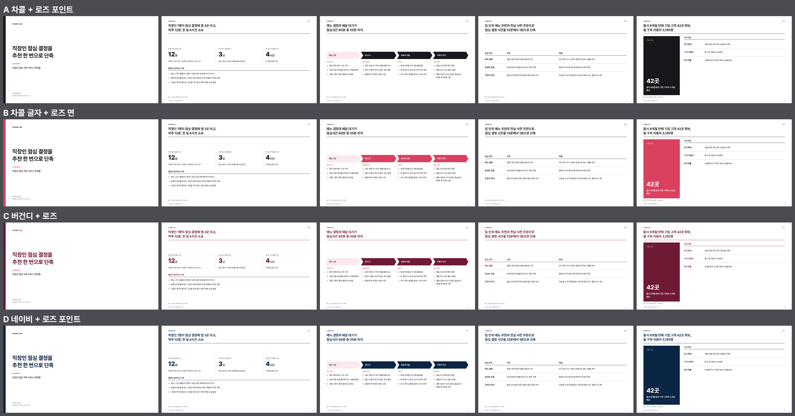

# bmc-ppt: 덱 제작 시스템

회사 소개 덱(투자자용 사업 소개, B2B 제품 소개서 등)을 컨설팅·PE 스타일로 만들고, 편집 가능한 PPTX, PDF, Figma로 내보낸다.
Claude Code에서 이 폴더를 열고 `/bmc-ppt`를 실행하면 아래 절차가 진행된다.

```
브리프 → 팩트 원장 → 헤드메시지 스토리라인(승인) → 조립 → 본문 → 문체 교정 → 기계 검사와 내보내기 → 처음 읽는 사람의 검토 → 열기
```



## 시작하기

준비물: macOS, [Claude Code](https://claude.com/claude-code), Node 22 이상, Google Chrome.
미리보기 PNG를 만들려면 `brew install poppler`가 필요하다. PowerPoint와 Figma 데스크톱 앱이 있으면 결과물을 바로 열 수 있다.

```bash
git clone https://github.com/minchan-ban/bmc-ppt.git
cd bmc-ppt
bash scripts/setup.sh --check   # 무엇이 빠졌는지 확인
bash scripts/setup.sh           # .venv, python-pptx, Pretendard 글꼴 설치, /humanize-korean 스킬 연결
```

### 1. 회사 정보 넣기

`brand.json`을 내 회사 정보로 고친다. 새 덱을 만들 때마다 이 값이 표지, 꼬리말, 뒤표지에 들어간다.

```json
{
  "company": "Your Company",          // 표지와 꼬리말의 회사명
  "brand": "#D9415F",                 // 강조색 (강조 막대, 라벨, 패널)
  "brand_soft": "#FBE9ED",            // 강조색의 옅은 채움
  "contact": {                        // 뒤표지 세 줄
    "담당자 이름과 직함": "홍길동 대표",
    "이메일": "hello@example.com",
    "전화번호": "example.com"
  }
}
```
(실제 파일에는 주석을 쓰지 않는다. 값을 고치지 않고 `/bmc-ppt`를 실행하면 Claude가 먼저 회사 정보를 묻는다.)

### 2. 원자료 넣기

덱에 쓸 지표, 시장 자료, 고객 사례를 `context/`에 넣는다 (`context/README.md` 참고). 덱의 수치는 이 자료에서만 가져오고, 자료에 없는 수치는 지어내지 않고 사용자에게 묻는다.

### 3. 덱 만들기

```bash
claude        # 이 폴더에서 Claude Code 실행
```
Claude Code에서 `/bmc-ppt` 또는 "투자자용 IR 덱 만들어줘"라고 요청한다. 단계마다 확인을 받으며 진행한다.
결과 예시는 `decks/_sample/`(가상 회사 '한끼랩'의 샘플 덱)에 있다. 도표 부품 14종(p48~p61, 원형·도넛·꺾은선·영역은 PowerPoint 기본 차트)을 예시 데이터로 채운 견본은 `decks/_chart-sample/`에 PDF, PPTX와 함께 있다. `.venv/bin/python scripts/build.py decks/_sample/deck.html --preview`로 직접 빌드해 볼 수 있다.

## 구조

덱 한 벌의 원본은 `decks/<이름>/deck.html` 하나이고, PPTX, PDF, Figma는 모두 여기서 만든다.

```
brand.json                  회사명, 브랜드 색, 뒤표지 연락처
.claude/skills/bmc-ppt/     /bmc-ppt 스킬 (제작 절차)
.claude/skills/humanize-korean  → vendor/im-not-ai (한국어 문체 교정 스킬)
harness/                    규칙의 정본과 검사기가 쓰는 어휘
  headline-rules.md           헤드메시지 규칙 H1~H12
  slide-rules.md              구성, 표, 도표, 색 규칙
  copy-rules.md               문체 규칙 C1~C12와 문체 교정 절차
  deck-types.md               덱 유형별 읽는 사람, 표준 구성, 어조
  review-prompt.md            처음 읽는 사람의 검토 지시문
  figma-export.md             Figma로 보내는 절차
  logo-rules.md               기업 로고를 투명 PNG로 만드는 절차와 덱에 넣는 규칙
  lexicon.json                검사기가 쓰는 어휘 목록
design/                     디자인 시스템
  deck.css                    토큰(색, Pretendard 굵기)과 팔레트 4종, 부품 스타일
  palettes.png                팔레트 4종 비교 그림
  parts.html                  부품 61종 (표·서사 25종, 컨설팅 도형 22종, 데이터 도표 10종, 기본 차트 4종)
  nchart.js                   기본 차트(원형, 도넛, 꺾은선, 영역)의 HTML 미리보기 렌더러. new_deck.py가 덱에 넣는다
  catalog.md                  전하려는 내용에 맞는 부품 고르기
  typography.md               Pretendard 굵기 구분
  fonts/                      Pretendard (SIL OFL)
scripts/
  setup.sh                    환경 확인과 준비
  new_deck.py                 부품을 골라 deck.html 조립
  check_deck.py               내용 검사 (헤드메시지, 문체, 수치 근거, 서식)
  copy_pass.py                문체 교정용 글자 꺼내기와 되돌려 넣기
  build.py                    검사 → PPTX → PDF → Figma용 HTML
  logo.py                     기업 로고 수집 → 배경 제거 → 자동 검사 → 미리보기
engine/
  html_dump.mjs, lib_cdp.mjs  Chrome으로 그린 요소의 위치와 모양을 기록
  html_to_pptx.py             그 기록을 PowerPoint 도형으로 조립
  native_chart.py             .nchart를 PowerPoint 기본 차트로 만듦 (데이터 편집 가능)
  freeze_charts.mjs           Figma용 HTML에 기본 차트의 SVG를 고정해 넣음
  check_layout.mjs            화면 검사 (글꼴, 줄 수, 넘침, 빈 공간)
  figma_post.js               Figma로 보낸 뒤 프레임 이름과 배치 정리
  site_logos.mjs              Chrome으로 홈페이지를 열어 로고 요소를 찾고 투명 PNG로 따냄
  svg_to_png.mjs              SVG를 투명 배경 PNG로 그림
assets/logos/               모은 로고 (투명 PNG, 출처 기록, 미리보기)
context/                    덱에 쓸 원자료를 두는 곳
decks/<이름>/               brief.md, facts.md, storyline.md, deck.html, out/
vendor/                     가져온 외부 프로젝트 3종 (vendor/README.md)
```

## 직접 실행할 때

```bash
python3 scripts/new_deck.py --list
python3 scripts/new_deck.py --type investor --palette rose --parts p01,p09,p10,p11,p15,p24 --title "덱 제목" -o decks/2026-10-x/deck.html
python3 scripts/check_deck.py decks/2026-10-x/storyline.md --storyline     # 헤드메시지만 먼저 검사
.venv/bin/python scripts/build.py decks/2026-10-x/deck.html --preview --open
```

로고가 필요할 때:

```bash
.venv/bin/python scripts/logo.py get "올리브영" --site oliveyoung.co.kr    # 결과와 미리보기는 assets/logos/
.venv/bin/python scripts/logo.py get "Coupang" --wiki "Coupang logo"
.venv/bin/python scripts/logo.py get "고객사" --file ~/Downloads/logo.jpg   # 가진 파일의 배경만 제거
```

`decks/_sample/`은 시스템 시험용 덱이다. 한끼랩은 가상의 회사이고 수치도 모두 예시다.

## 설계에서 정한 것

| 정한 것 | 내용 | 이유 |
|---|---|---|
| 원본 | HTML 하나 | PPTX와 Figma를 같은 원본에서 만들 수 있고, 기계 검사가 빠르다 |
| 헤드메시지 | 명사형 종결, 2줄 이내, 수치는 본문과 팩트 원장에 있어야 함 | 명사형 종결은 주제형 제목으로 미끄러지기 쉬워서 검사기가 그 경우를 FAIL로 잡는다 |
| 글꼴 | Pretendard 하나, 굵기 5종을 용도별로 구분 | 크기 대신 굵기로 위계를 만든다 |
| 색 | 팔레트 4종을 덱마다 고른다. 기본은 `rose`(차콜 + 로즈 포인트)이고 `rose-panel`, `berry`, `navy-rose`가 있다. 강조색은 모두 브랜드 색(기본값 로즈) | 자료의 성격에 따라 브랜드의 세기를 조절한다. 브랜드 색은 `brand.json` 한 곳에서 바꾼다 |
| 도표 | SVG 대신 div 도형 | SVG는 PPTX에서 그림으로 변환되어 수치를 고칠 수 없다 |
| 수치 | 팩트 원장에 없는 수치는 쓰지 않음 | 지어낸 수치가 덱에 들어가는 것을 막는다 |

## 편집과 관련해 알아 둘 것

- **PPTX**: 글자는 글상자, 표는 PowerPoint 표, 막대와 화살표는 도형으로 들어간다. 헤드메시지는 제목 개체 틀에 있어서 개요 보기와 슬라이드 탐색에 나온다. 글머리표 목록은 글상자 하나여서 줄을 이어서 더할 수 있다. 테마 글꼴과 테마 색도 덱의 토큰으로 맞춰져 있다.
- **Figma**: 슬라이드마다 프레임 하나이고 안쪽은 대부분 오토 레이아웃이다. 알려진 차이는 `harness/figma-export.md`에 있다.
- PPTX나 Figma에서 고친 내용은 `deck.html`에 돌아오지 않는다. 문구와 수치는 `deck.html`에서 고치고 다시 내보내는 쪽이 안전하다.
- 덱을 받는 사람의 컴퓨터에 Pretendard가 없으면 다른 글꼴로 바뀌어 보인다. 밖으로 보낼 때는 PDF를 함께 보내거나 PowerPoint의 글꼴 포함 옵션으로 저장한다.

## 아직 없는 것

- 꺾은선 도표 (선은 PPTX에서 그림이 되어 편집할 수 없으므로 세로 막대나 점 추이로 대신한다)
- 비례 원, 도트 매트릭스, 소형 도표 나열 등 원본 저장소의 일부 부품 (`design/catalog.md`에 목록이 있다)
- 발표자 노트
- Figma 변수와 텍스트 스타일 연결
- 영문 덱용 헤드메시지 검사 (검사기는 한국어 종결을 기준으로 한다)

## 라이선스와 출처

- `vendor/`의 외부 프로젝트 3종은 MIT 라이선스다. 가져온 커밋과 쓰는 방식은 `vendor/README.md`에 있다.
- `design/fonts/`의 Pretendard는 SIL Open Font License를 따른다 (`design/fonts/OFL-Pretendard.txt`).
