# bmc-ppt: 덱 제작 시스템

회사 소개 덱(투자자용 사업 소개, B2B 제품 소개서 등)을 컨설팅·PE 스타일로 만들고, 편집 가능한 PPTX, PDF, Figma로 내보낸다.
Claude Code에서 이 폴더를 열고 `/bmc-ppt`를 실행하면 아래 절차가 진행된다.

```
브리프 → 팩트 원장 → 헤드메시지 스토리라인(승인) → 조립 → 본문 → 문체 교정 → 기계 검사와 내보내기 → 처음 읽는 사람의 검토 → 열기
```


## 시작하기

준비물: macOS, [Claude Code](https://claude.com/claude-code), Node 22 이상, Google Chrome.
미리보기 PNG를 만들려면 `brew install poppler`가 필요하다. PowerPoint와 Figma 데스크톱 앱이 있으면 결과물을 바로 열 수 있다.

```bash
git clone https://github.com/minchan-ban/bmc-ppt.git
cd bmc-ppt
bash scripts/setup.sh --check   # 무엇이 빠졌는지 확인
bash scripts/setup.sh           # .venv, python-pptx, Pretendard 글꼴 설치, /humanize-korean 스킬 연결
```

### 1. 회사 정보 넣기

`brand.json`을 내 회사 정보로 고친다. 새 덱을 만들 때마다 이 값이 표지, 꼬리말, 뒤표지에 들어간다.

```json
{
  "company": "Your Company",          // 표지와 꼬리말의 회사명
  "brand": "#D9415F",                 // 강조색 (강조 막대, 라벨, 패널)
  "brand_soft": "#FBE9ED",            // 강조색의 옅은 채움
  "contact": {                        // 뒤표지 세 줄
    "담당자 이름과 직함": "홍길동 대표",
    "이메일": "hello@example.com",
    "전화번호": "example.com"
  }
}
```
(실제 파일에는 주석을 쓰지 않는다. 값을 고치지 않고 `/bmc-ppt`를 실행하면 Claude가 먼저 회사 정보를 묻는다.)

### 2. 원자료 넣기

덱에 쓸 지표, 시장 자료, 고객 사례를 `context/`에 넣는다 (`context/README.md` 참고). 덱의 수치는 이 자료에서만 가져오고, 자료에 없는 수치는 지어내지 않고 사용자에게 묻는다.

### 3. 덱 만들기

```bash
claude        # 이 폴더에서 Claude Code 실행
```
Claude Code에서 `/bmc-ppt` 또는 "투자자용 IR 덱 만들어줘"라고 요청한다. 단계마다 확인을 받으며 진행한다.
결과 예시는 `decks/_sample/`(가상 회사 '한끼랩'의 샘플 덱)에 있다. 도표 부품 26종을 예시 데이터로 채운 견본은 `decks/_chart-sample/`에 PDF, PPTX와 함께 있고, 그림으로 고르는 방법은 아래 [도표 갤러리](#도표-갤러리-어떤-그림을-고를까)에 있다. `.venv/bin/python scripts/build.py decks/_sample/deck.html --preview`로 직접 빌드해 볼 수 있다.

## 도표 갤러리: 어떤 그림을 고를까

숫자를 보여 주는 부품(도표) 26종을 실제 슬라이드 모습으로 모았다. 그림 속 회사와 수치는 모두 지어낸 예시다.
도표를 몰라도 괜찮다. **"내가 이 장에서 하고 싶은 말"** 을 아래 표에서 찾고, 그 묶음의 그림을 보고 고르면 된다.
덱을 만들 때 Claude에게 부품 번호로 말하면 그 모양으로 그린다. 예: "매출 구성은 p58 도넛으로 그려줘"

| 하고 싶은 말 | 볼 묶음 | 부품 |
|---|---|---|
| "A가 B보다 크다", "목표를 넘겼다" | [1. 크기 비교](#1-크기를-비교할-때) | p06, p28, p54, p55, p56 |
| "이만큼 늘었다", "점점 벌어진다" | [2. 시간에 따른 변화](#2-시간에-따라-어떻게-변했는지-보일-때) | p07, p50, p32, p60, p51 |
| "전체 중 절반이 이것이다" | [3. 전체 중 차지하는 몫](#3-전체-가운데-얼마를-차지하는지-보일-때) | p08, p48, p58, p59, p27, p61, p53 |
| "무엇 때문에 늘었다", "어디서 빠져나간다", "시장이 이만큼 크다" | [4. 늘고 빠진 이유와 규모](#4-늘고-빠진-이유와-규모를-보일-때) | p26, p29, p49 |
| "우리만 이 자리에 있다" | [5. 위치와 관계](#5-위치와-관계를-보일-때) | p13, p30, p31 |
| "여러 숫자를 한눈에" | [6. 여러 숫자를 한 장에](#6-여러-숫자를-한-장에-모을-때) | p52, p37, p57 |

**슬라이드 한 장을 읽는 법.** 모든 장은 같은 순서로 읽힌다.

1. **맨 위의 굵은 문장(헤드메시지)이 결론이다.** 이 문장만 이어 읽어도 덱 전체의 이야기가 된다.
2. **왼쪽 도표가 그 결론의 근거다.** 도표 바로 위 줄에 무엇을 잰 숫자인지와 단위가 적혀 있다.
3. **빨간색(강조색)은 한 장에 하나의 주인공에만 쓴다.** 회색은 비교 대상이다. 빨간 것이 헤드메시지가 말하는 그것이다.
4. **오른쪽은 "그래서 무슨 뜻인가"다.** 도표에서 읽어 낸 사실을 문장으로 적는다.
5. **맨 아래 출처 줄**에 숫자를 어디서 가져왔는지 적는다. 출처가 없으면 검사기가 덱을 내보내지 않는다.

**PowerPoint에서 고치는 법은 두 가지다.** 아래 설명마다 어느 쪽인지 적었다.

- **도형:** 막대와 점이 PowerPoint 도형으로 들어간다. 글자와 숫자는 바로 고칠 수 있고, 막대 길이는 도형 크기를 끌어서 바꾼다. 다시 만들 때는 `deck.html`의 숫자를 고치고 빌드하면 길이까지 맞춰진다.
- **기본 차트:** PowerPoint의 차트 기능으로 들어간다. 차트를 누르고 **차트 디자인 → 데이터 편집**을 누르면 엑셀 창이 열리고, 숫자를 바꾸면 그림도 같이 바뀐다.

### 1. 크기를 비교할 때

#### 가로 막대 `p06`
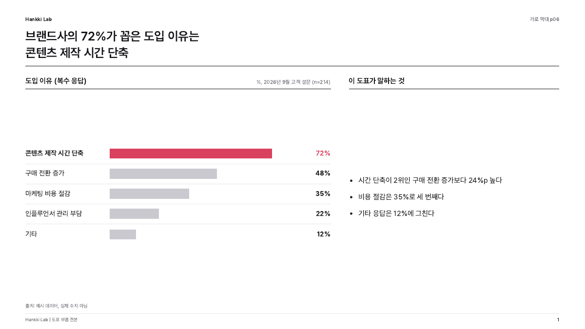

- **이럴 때 쓴다:** 여러 항목 가운데 무엇이 가장 큰지 순위를 보일 때. 예: 고객이 꼽은 도입 이유
- **읽는 법:** 막대가 길수록 크다. 큰 것부터 위에서 아래로 놓는다. 항목 이름이 길어도 잘 들어간다.
- **PowerPoint에서:** 도형

#### 묶음 세로 막대 `p28`
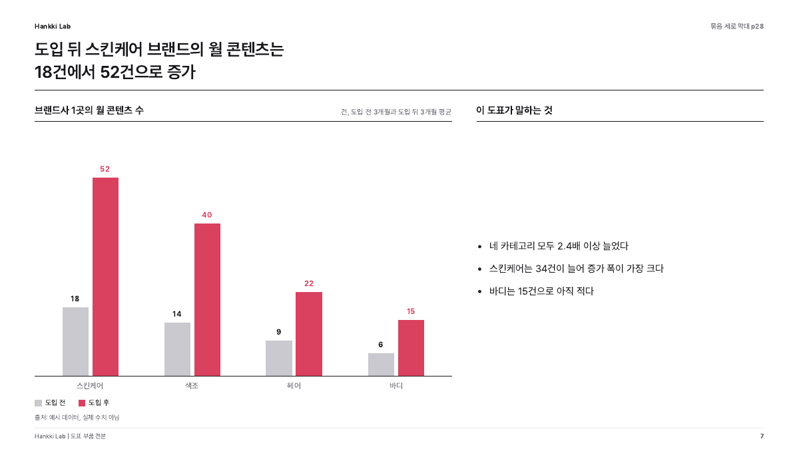

- **이럴 때 쓴다:** 같은 항목을 두 가지 기준으로 나란히 비교할 때. 예: 도입 전과 도입 후, 우리와 업계 평균
- **읽는 법:** 한 쌍에서 회색이 비교 대상(도입 전), 빨간색이 주인공(도입 후)이다. 쌍마다 키 차이를 본다.
- **PowerPoint에서:** 도형

#### 전후 비교 덤벨 `p54`
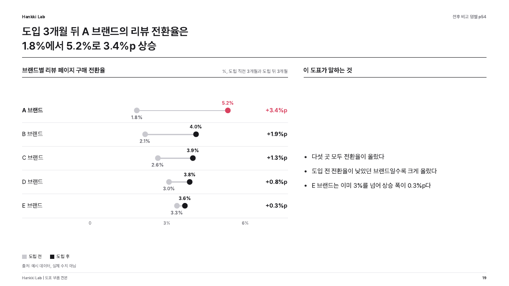

- **이럴 때 쓴다:** 항목마다 "얼마에서 얼마로" 바뀌었는지, 그 간격을 강조할 때. 묶음 막대보다 간격이 잘 보인다.
- **읽는 법:** 아령처럼 생겼다. 회색 점이 전, 검은 점이 후다. 두 점을 잇는 선이 길수록 많이 바뀐 것이다.
- **PowerPoint에서:** 도형

#### 증감 가로 막대 `p55`
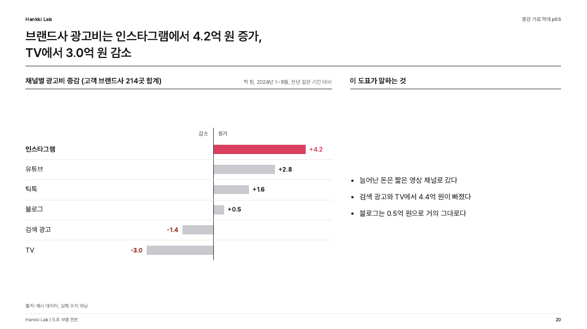

- **이럴 때 쓴다:** 늘어난 것과 줄어든 것이 섞여 있을 때. 예: 채널별 광고비가 작년보다 얼마나 늘고 줄었는지
- **읽는 법:** 가운데 세로선이 0이다. 오른쪽으로 뻗으면 늘어난 것, 왼쪽으로 뻗으면 줄어든 것이다. 줄어든 값은 짙은 빨강 글자다.
- **PowerPoint에서:** 도형

#### 목표 대비 달성 `p56`
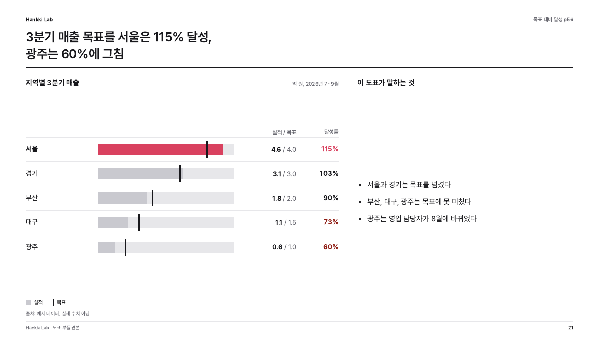

- **이럴 때 쓴다:** 목표를 넘긴 곳과 못 미친 곳을 함께 보일 때. 예: 지역별, 팀별 분기 실적
- **읽는 법:** 막대가 실적이고, 막대를 가로지르는 검은 세로선이 목표다. 막대가 선을 넘으면 달성이다. 오른쪽 끝에 달성률을 적는다.
- **PowerPoint에서:** 도형

### 2. 시간에 따라 어떻게 변했는지 보일 때

#### 세로 막대 추이 `p07`
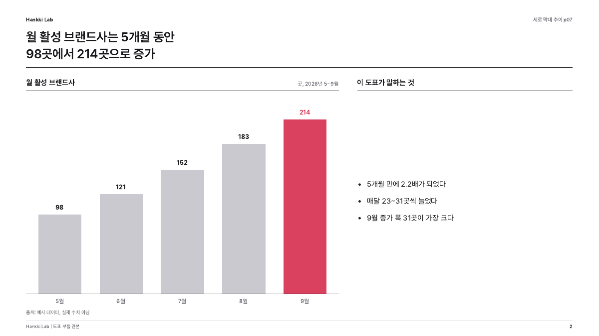

- **이럴 때 쓴다:** 몇 달, 몇 년 동안 한 숫자가 어떻게 커졌는지 보일 때. 시점이 대여섯 개일 때 가장 잘 읽힌다.
- **읽는 법:** 왼쪽에서 오른쪽으로 시간이 흐른다. 막대 위의 숫자가 그 시점의 값이다. 마지막 막대가 지금이다.
- **PowerPoint에서:** 도형

#### 성장률 표시 세로 막대 `p50`
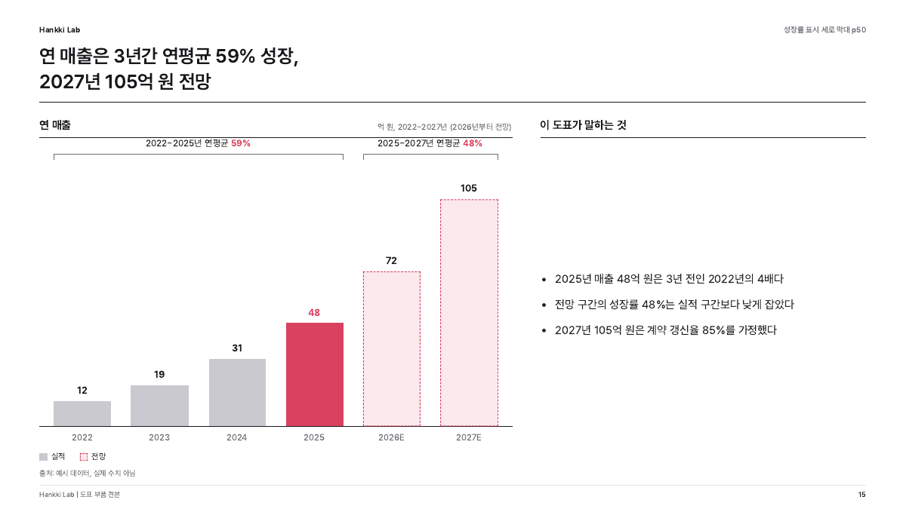

- **이럴 때 쓴다:** 지금까지의 실적과 앞으로의 전망을 한 그림에 넣고, "매년 몇 %씩 컸다"를 함께 말할 때. 투자 자료의 매출 장에 자주 쓴다.
- **읽는 법:** 꽉 찬 막대는 실제로 일어난 일, 점선 막대는 전망이다. 위의 괄호가 구간이고, 그 구간에서 매년 평균 몇 %씩 컸는지(연평균 성장률)를 적는다.
- **PowerPoint에서:** 도형

#### 점 추이 `p32`
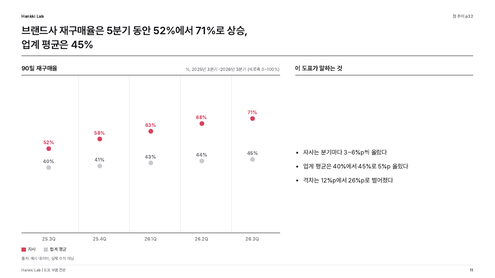

- **이럴 때 쓴다:** 두 숫자의 흐름을 같이 보여 주며 "격차가 벌어진다"를 말할 때. 막대 두 개씩 세우기에는 시점이 많을 때.
- **읽는 법:** 시점마다 점이 두 개 있다. 빨간 점이 주인공, 회색 점이 비교 대상이다. 위아래 거리가 곧 격차다.
- **PowerPoint에서:** 도형

#### 꺾은선 `p60`
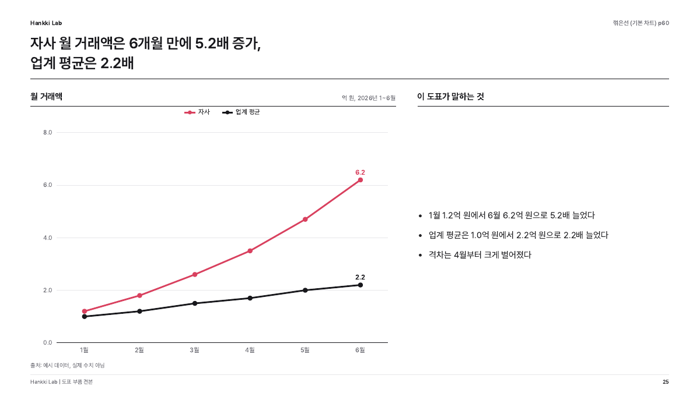

- **이럴 때 쓴다:** 월별처럼 시점이 많은 흐름을 선으로 이어 보일 때. 기울기로 속도를 보여 준다.
- **읽는 법:** 선이 가파르게 올라갈수록 빨리 큰 것이다. 계열이 여럿이면 마지막 점에만 값을 붙여 끝 지점끼리 비교하게 한다.
- **PowerPoint에서:** 기본 차트 (데이터 편집 가능)

#### 소형 도표 나열 `p51`
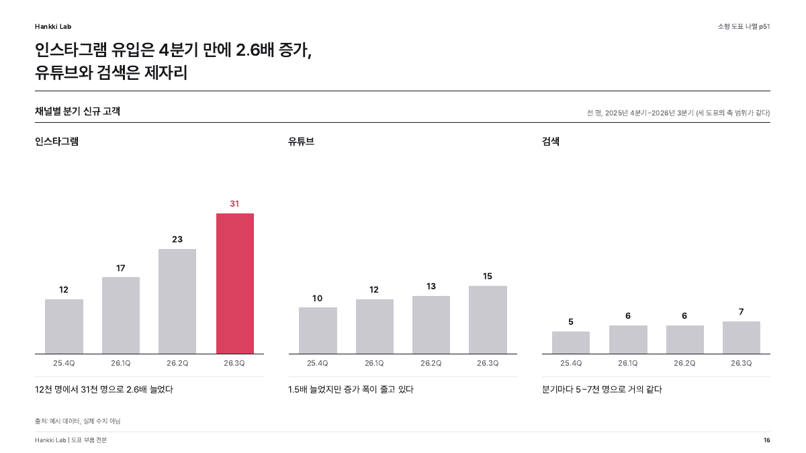

- **이럴 때 쓴다:** 같은 숫자를 대상별로 쪼개 "어디는 크고 어디는 제자리"를 보일 때. 예: 채널별 신규 고객
- **읽는 법:** 작은 그림 세 개의 세로 눈금이 모두 같다. 그래서 막대 높이를 그대로 서로 비교해도 된다. 그림 아래에 대상마다 읽을 점을 한 줄씩 적는다.
- **PowerPoint에서:** 도형

### 3. 전체 가운데 얼마를 차지하는지 보일 때

#### 구성비 누적 막대와 표 `p08`
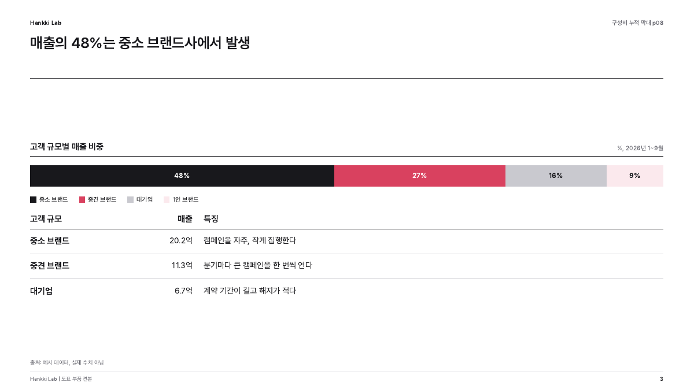

- **이럴 때 쓴다:** 100%를 몇 조각으로 나눈 비중과, 조각마다의 금액이나 설명을 함께 보일 때
- **읽는 법:** 긴 막대 하나가 전체(100%)다. 조각의 길이가 비중이다. 아래 표에서 금액과 특징을 읽는다.
- **PowerPoint에서:** 도형

#### 도트 매트릭스 `p48`
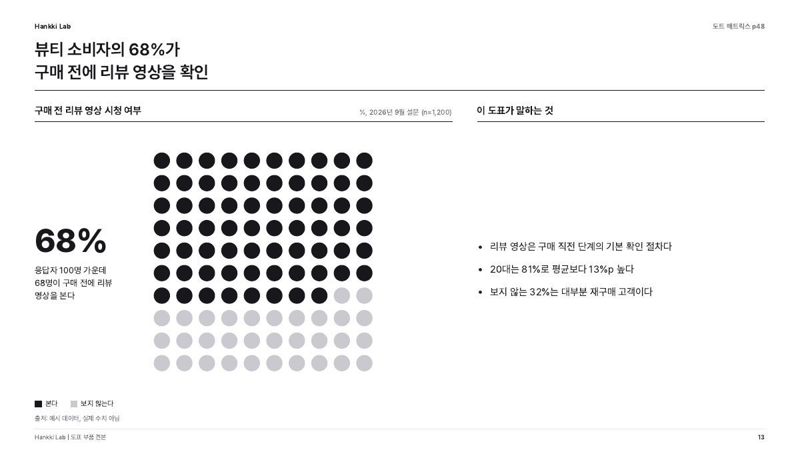

- **이럴 때 쓴다:** 비율 하나를 "100명 가운데 68명"처럼 실감 나게 보일 때. 설문 결과에 잘 맞는다.
- **읽는 법:** 점 100개가 전체다. 검게 칠한 점의 개수가 비율이다.
- **PowerPoint에서:** 도형

#### 도넛 `p58`
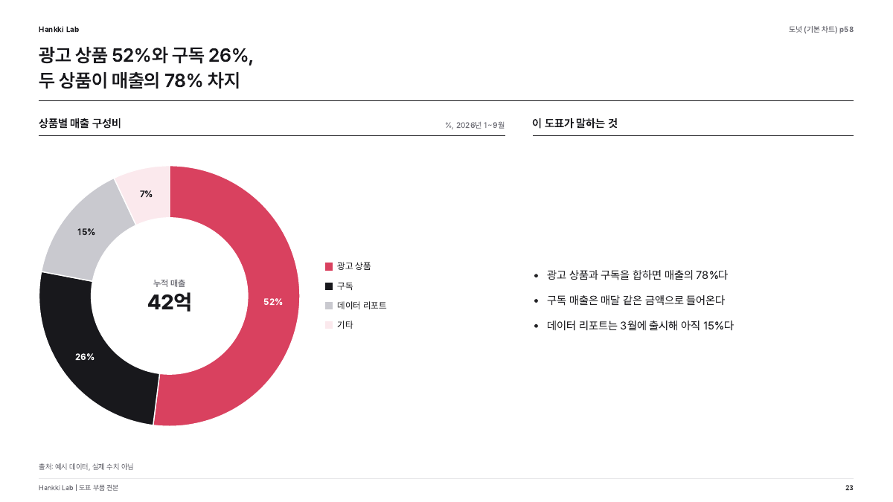

- **이럴 때 쓴다:** 매출 구성처럼 전체를 몇 조각으로 나누고, 가운데에 합계를 크게 보일 때. 조각은 5개 이하로 쓴다.
- **읽는 법:** 고리 한 바퀴가 전체(100%)다. 조각이 클수록 몫이 크다. 가운데 숫자가 전체 합계다.
- **PowerPoint에서:** 기본 차트 (데이터 편집 가능). 가운데 합계는 따로 놓인 글상자라서 직접 고친다.

#### 원형 `p59`
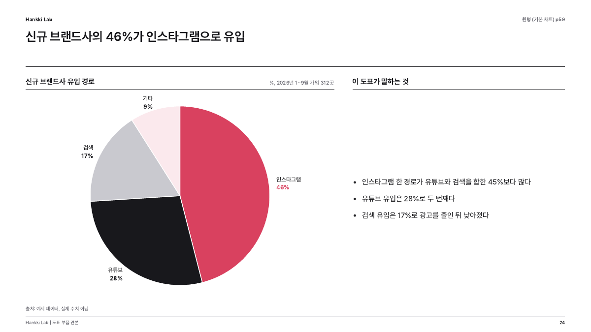

- **이럴 때 쓴다:** 조각이 서너 개뿐이고 하나가 절반 가까이를 차지해서, "이것이 대부분이다"를 말할 때
- **읽는 법:** 원 전체가 100%다. 바깥에 항목 이름과 비율이 붙는다. 조각 크기가 비슷하면 눈으로 구분하기 어려우므로 가로 막대(p06)를 쓴다.
- **PowerPoint에서:** 기본 차트 (데이터 편집 가능)

#### 누적 세로 막대 `p27`
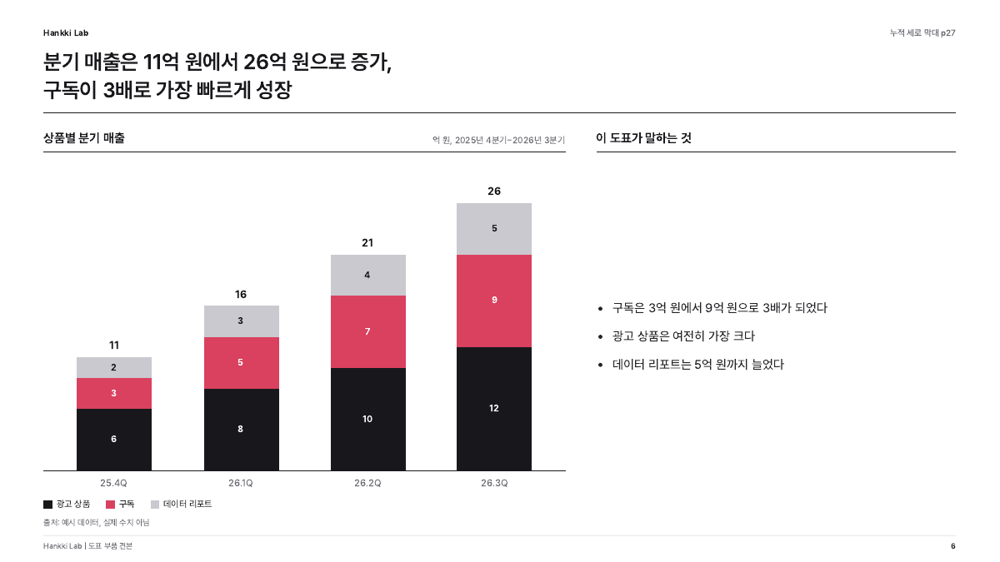

- **이럴 때 쓴다:** 전체가 커지는 동안 그 안의 구성도 어떻게 바뀌었는지 함께 보일 때. 예: 상품별 분기 매출
- **읽는 법:** 막대 전체 높이가 합계이고, 막대 안의 칸이 상품별 몫이다. 빨간 칸이 커지는 속도를 따라가면 된다.
- **PowerPoint에서:** 도형

#### 누적 영역 `p61`
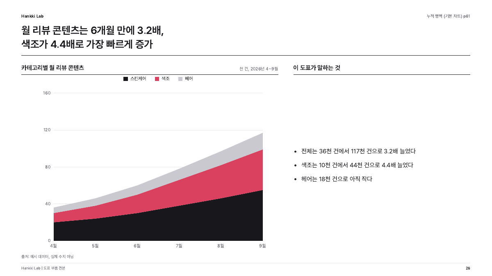

- **이럴 때 쓴다:** 누적 세로 막대와 같은 이야기를 시점이 많을 때 면으로 이어서 보일 때
- **읽는 법:** 맨 위 테두리가 합계다. 색 띠 하나의 두께가 그 계열의 몫이다. 띠가 두꺼워질수록 그 계열이 커진 것이다.
- **PowerPoint에서:** 기본 차트 (데이터 편집 가능)

#### 메코 차트 `p53`
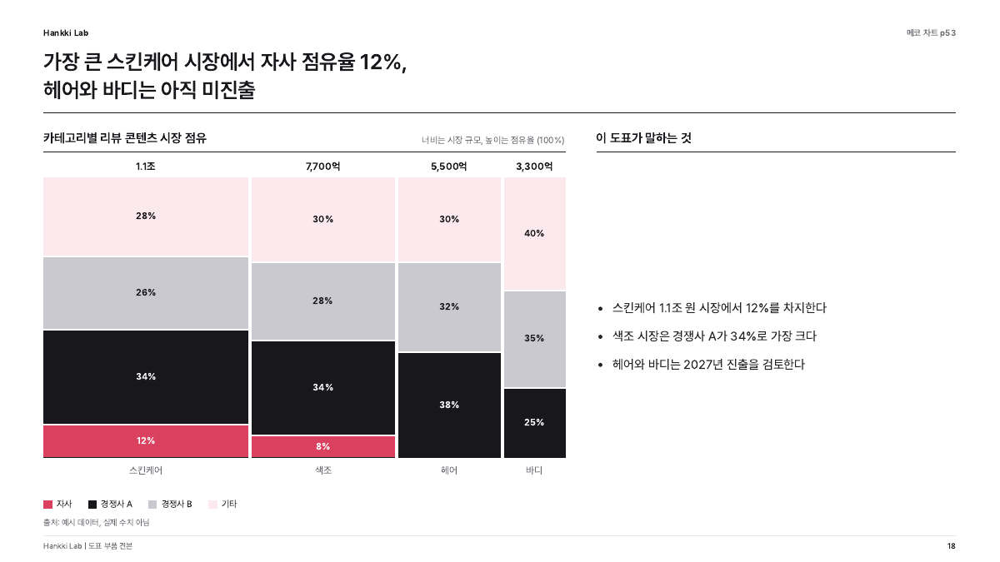

- **이럴 때 쓴다:** 시장마다 크기가 다르고, 그 안에서 누가 얼마나 차지하는지를 한 장에 보일 때. 컨설팅 회사가 시장 구조를 설명할 때 자주 쓴다.
- **읽는 법:** 기둥의 **너비**가 시장 크기, 기둥 안 칸의 **높이**가 점유율이다. 넓은 기둥에서 빨간 칸이 크면 큰 시장을 잘 잡고 있는 것이다.
- **PowerPoint에서:** 도형

### 4. 늘고 빠진 이유와 규모를 보일 때

#### 폭포 `p26`
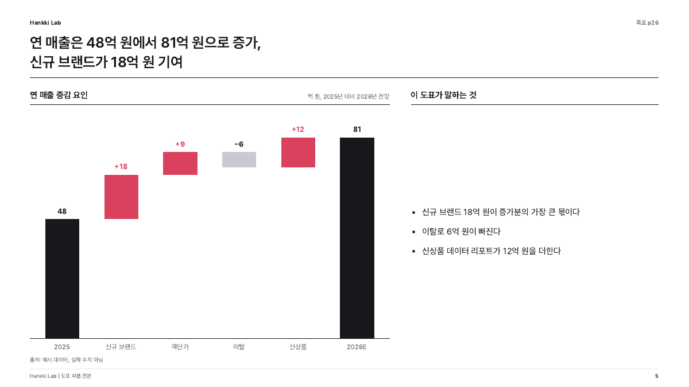

- **이럴 때 쓴다:** 시작 숫자가 끝 숫자로 바뀌는 동안 무엇이 얼마나 더하고 뺐는지 보일 때. 예: 작년 매출 48억이 올해 81억이 된 이유
- **읽는 법:** 맨 왼쪽 검은 막대가 출발점, 맨 오른쪽 검은 막대가 도착점이다. 사이의 빨간 막대는 더한 것, 회색 막대는 뺀 것이다. 계단을 따라 읽는다.
- **PowerPoint에서:** 도형

#### 깔때기 `p29`
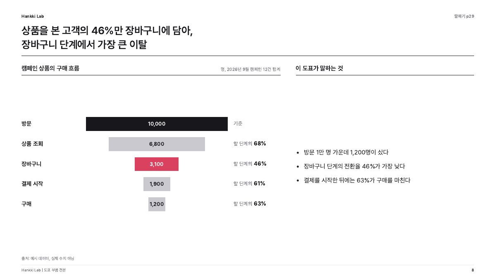

- **이럴 때 쓴다:** 방문에서 구매까지 단계마다 사람이 얼마나 남고 빠지는지 보일 때. 어느 단계를 고쳐야 하는지 짚을 때 쓴다.
- **읽는 법:** 위에서 아래로 단계가 진행된다. 막대가 짧아질수록 사람이 빠진 것이다. 오른쪽 비율은 앞 단계에서 다음 단계로 넘어간 사람의 비율이다. 빨간 막대가 가장 많이 빠지는 단계다.
- **PowerPoint에서:** 도형

#### 시장 규모 원 `p49`
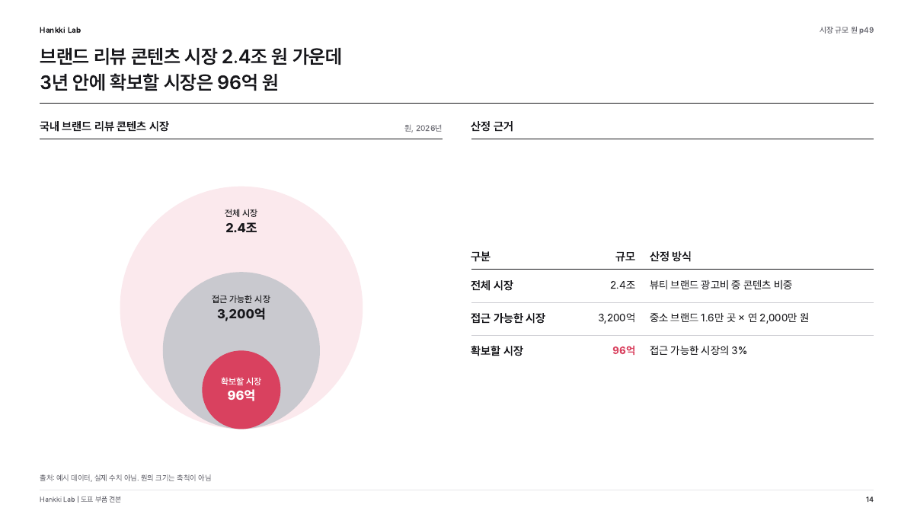

- **이럴 때 쓴다:** 투자 자료에서 "전체 시장이 이만큼이고, 우리가 노릴 수 있는 시장과 실제로 가져올 시장은 이만큼"을 보일 때(TAM, SAM, SOM)
- **읽는 법:** 큰 원 안에 작은 원이 들어 있다. 가장 큰 원이 전체 시장, 가운데가 접근할 수 있는 시장, 빨간 원이 확보할 시장이다. 오른쪽 표에 각 숫자를 어떻게 계산했는지 적는다.
- **PowerPoint에서:** 도형

### 5. 위치와 관계를 보일 때

#### 2×2 포지셔닝 `p13`
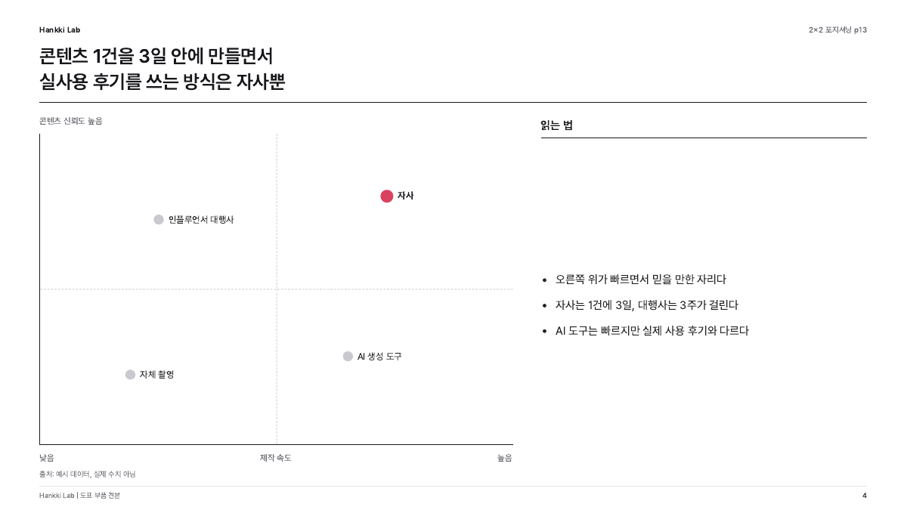

- **이럴 때 쓴다:** 두 가지 기준으로 경쟁자와 우리의 자리를 비교할 때. 예: 속도와 신뢰도
- **읽는 법:** 오른쪽 위로 갈수록 두 기준 모두 좋다. 빨간 점이 우리다. 네 칸 가운데 우리만 있는 칸이 차별점이다.
- **PowerPoint에서:** 도형

#### 분산형 `p30`
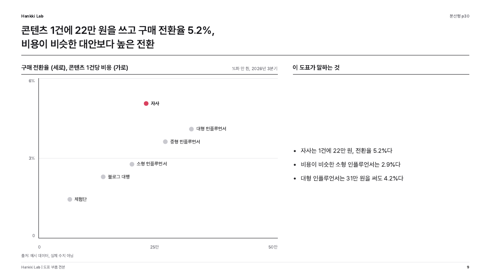

- **이럴 때 쓴다:** 두 숫자 사이의 관계(돈을 더 쓰면 효과도 큰가)를 보이고, 우리가 그 흐름에서 벗어나 있음을 보일 때
- **읽는 법:** 오른쪽으로 갈수록 비용이 크고, 위로 갈수록 효과가 좋다. 회색 점들이 만드는 흐름보다 빨간 점이 위에 있으면, 같은 돈으로 더 좋은 결과를 낸 것이다.
- **PowerPoint에서:** 도형

#### 버블 `p31`
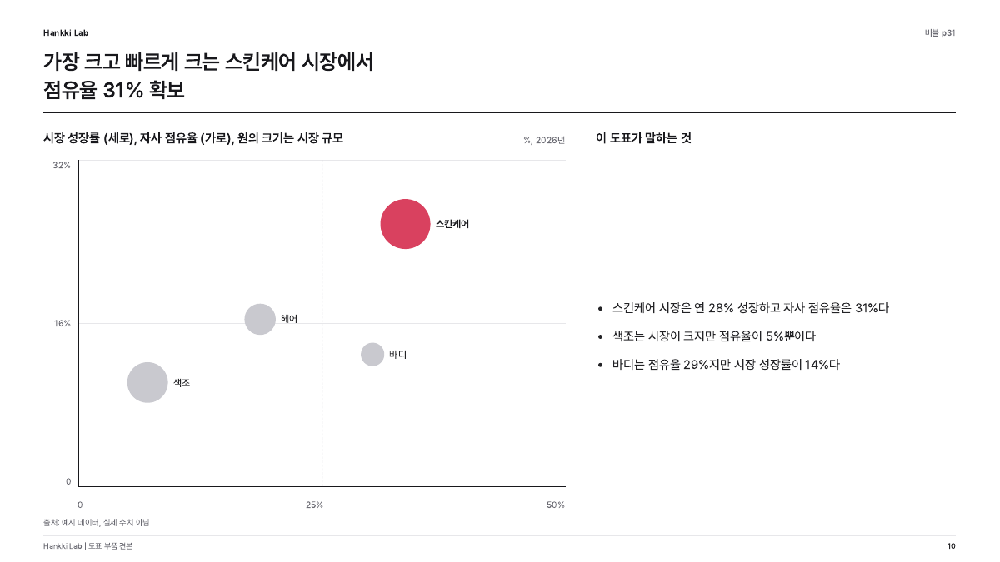

- **이럴 때 쓴다:** 분산형에 크기(시장 규모, 매출)까지 더해 세 가지를 한 번에 보일 때
- **읽는 법:** 점의 위치는 분산형과 같고, 원이 클수록 그 시장이 크다. 오른쪽 위의 큰 빨간 원이 "크고, 빨리 크고, 우리가 많이 가진" 시장이다.
- **PowerPoint에서:** 도형

### 6. 여러 숫자를 한 장에 모을 때

#### KPI 대시보드 `p52`
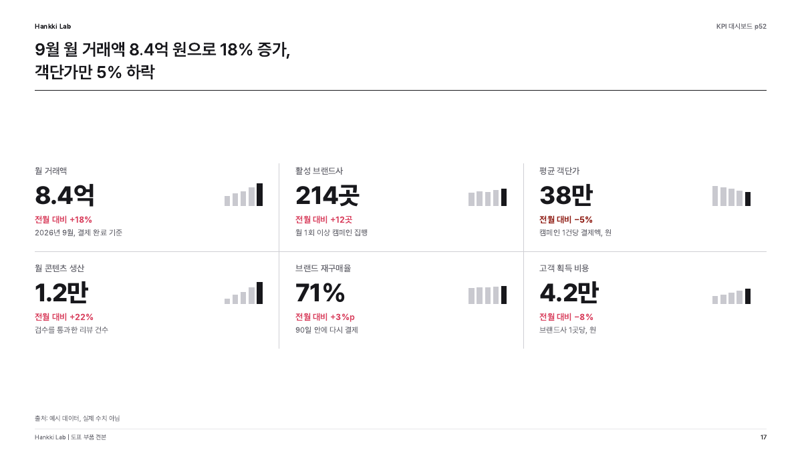

- **이럴 때 쓴다:** 핵심 지표 여섯 개의 지금 수준과 방향을 한 장에서 보일 때. 월간 보고나 투자자 업데이트에 쓴다.
- **읽는 법:** 칸마다 큰 숫자가 지금 값이다. 그 아래가 지난달보다 나아졌는지(빨강) 나빠졌는지(짙은 빨강)다. 오른쪽 작은 막대 다섯 개가 최근 흐름이다.
- **PowerPoint에서:** 도형

#### 히트맵 표 `p37`
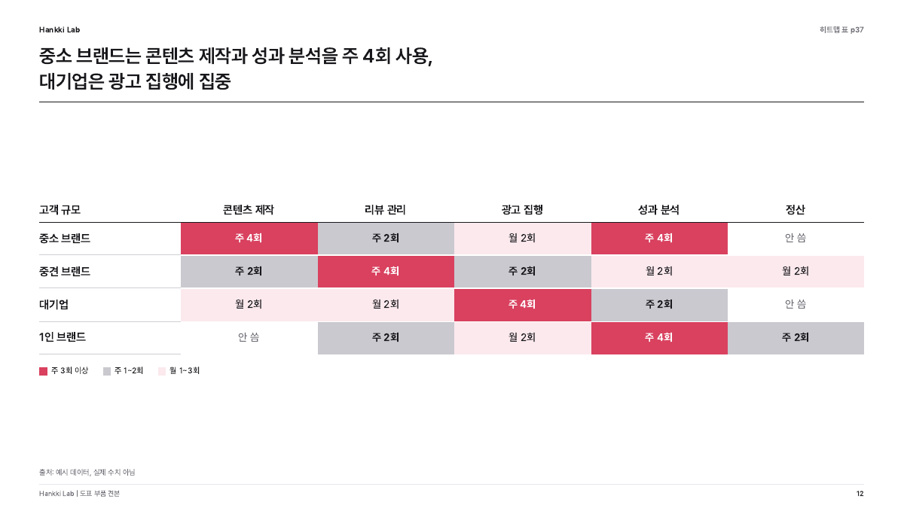

- **이럴 때 쓴다:** 항목과 기준이 많은 표에서 강한 곳과 약한 곳을 한눈에 보일 때. 예: 고객 유형별로 자주 쓰는 기능
- **읽는 법:** 빨간 칸이 가장 크고, 회색, 옅은 분홍 순서로 작아진다. 표 아래 범례에 색마다 뜻을 적는다. 빨간 칸이 몰린 줄이나 열을 찾으면 된다.
- **PowerPoint에서:** 표 (칸의 글자와 색을 바로 고칠 수 있다)

#### 코호트 리텐션 표 `p57`
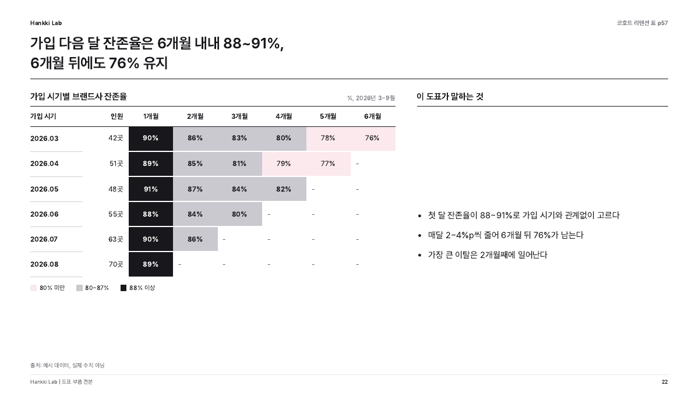

- **이럴 때 쓴다:** 고객이 가입한 뒤 시간이 지나도 얼마나 남아 있는지(잔존율)를 가입 시기별로 보일 때. 투자자가 서비스의 건강도를 볼 때 가장 먼저 찾는 표다.
- **읽는 법:** 한 줄이 같은 달에 가입한 고객 묶음이다. 오른쪽으로 갈수록 가입 뒤 시간이 지난 것이고, 칸의 숫자가 그때까지 남은 비율이다. 계단 모양으로 빈 칸은 아직 그 시간이 지나지 않은 칸이다.
- **PowerPoint에서:** 표

전체 견본 덱(28장)은 [`decks/_chart-sample/`](decks/_chart-sample/)에 PDF와 PPTX로 있다. 견본을 다시 만들려면 `python3 decks/_chart-sample/make_deck.py decks/_chart-sample/deck.html`을 실행하고 `scripts/build.py`로 빌드한다. 갤러리 이미지는 그 PDF에서 장마다 잘라 `docs/charts/`에 둔다.

## 구조

덱 한 벌의 원본은 `decks/<이름>/deck.html` 하나이고, PPTX, PDF, Figma는 모두 여기서 만든다.

```
brand.json                  회사명, 브랜드 색, 뒤표지 연락처
.claude/skills/bmc-ppt/     /bmc-ppt 스킬 (제작 절차)
.claude/skills/humanize-korean  → vendor/im-not-ai (한국어 문체 교정 스킬)
harness/                    규칙의 정본과 검사기가 쓰는 어휘
  headline-rules.md           헤드메시지 규칙 H1~H12
  slide-rules.md              구성, 표, 도표, 색 규칙
  copy-rules.md               문체 규칙 C1~C12와 문체 교정 절차
  deck-types.md               덱 유형별 읽는 사람, 표준 구성, 어조
  review-prompt.md            처음 읽는 사람의 검토 지시문
  figma-export.md             Figma로 보내는 절차
  logo-rules.md               기업 로고를 투명 PNG로 만드는 절차와 덱에 넣는 규칙
  lexicon.json                검사기가 쓰는 어휘 목록
design/                     디자인 시스템
  deck.css                    토큰(색, Pretendard 굵기)과 팔레트 4종, 부품 스타일
  palettes.png                팔레트 4종 비교 그림
  parts.html                  부품 61종 (표·서사 25종, 컨설팅 도형 22종, 데이터 도표 10종, 기본 차트 4종)
  nchart.js                   기본 차트(원형, 도넛, 꺾은선, 영역)의 HTML 미리보기 렌더러. new_deck.py가 덱에 넣는다
  catalog.md                  전하려는 내용에 맞는 부품 고르기
  typography.md               Pretendard 굵기 구분
  fonts/                      Pretendard (SIL OFL)
scripts/
  setup.sh                    환경 확인과 준비
  new_deck.py                 부품을 골라 deck.html 조립
  check_deck.py               내용 검사 (헤드메시지, 문체, 수치 근거, 서식)
  copy_pass.py                문체 교정용 글자 꺼내기와 되돌려 넣기
  build.py                    검사 → PPTX → PDF → Figma용 HTML
  logo.py                     기업 로고 수집 → 배경 제거 → 자동 검사 → 미리보기
engine/
  html_dump.mjs, lib_cdp.mjs  Chrome으로 그린 요소의 위치와 모양을 기록
  html_to_pptx.py             그 기록을 PowerPoint 도형으로 조립
  native_chart.py             .nchart를 PowerPoint 기본 차트로 만듦 (데이터 편집 가능)
  freeze_charts.mjs           Figma용 HTML에 기본 차트의 SVG를 고정해 넣음
  check_layout.mjs            화면 검사 (글꼴, 줄 수, 넘침, 빈 공간)
  figma_post.js               Figma로 보낸 뒤 프레임 이름과 배치 정리
  site_logos.mjs              Chrome으로 홈페이지를 열어 로고 요소를 찾고 투명 PNG로 따냄
  svg_to_png.mjs              SVG를 투명 배경 PNG로 그림
assets/logos/               모은 로고 (투명 PNG, 출처 기록, 미리보기)
context/                    덱에 쓸 원자료를 두는 곳
decks/<이름>/               brief.md, facts.md, storyline.md, deck.html, out/
docs/charts/                README 도표 갤러리 이미지 (decks/_chart-sample에서 만듦)
vendor/                     가져온 외부 프로젝트 3종 (vendor/README.md)
```

## 직접 실행할 때

```bash
python3 scripts/new_deck.py --list
python3 scripts/new_deck.py --type investor --palette rose --parts p01,p09,p10,p11,p15,p24 --title "덱 제목" -o decks/2026-10-x/deck.html
python3 scripts/check_deck.py decks/2026-10-x/storyline.md --storyline     # 헤드메시지만 먼저 검사
.venv/bin/python scripts/build.py decks/2026-10-x/deck.html --preview --open
```

로고가 필요할 때:

```bash
.venv/bin/python scripts/logo.py get "올리브영" --site oliveyoung.co.kr    # 결과와 미리보기는 assets/logos/
.venv/bin/python scripts/logo.py get "Coupang" --wiki "Coupang logo"
.venv/bin/python scripts/logo.py get "고객사" --file ~/Downloads/logo.jpg   # 가진 파일의 배경만 제거
```

`decks/_sample/`은 시스템 시험용 덱이다. 한끼랩은 가상의 회사이고 수치도 모두 예시다.

## 설계에서 정한 것

| 정한 것 | 내용 | 이유 |
|---|---|---|
| 원본 | HTML 하나 | PPTX와 Figma를 같은 원본에서 만들 수 있고, 기계 검사가 빠르다 |
| 헤드메시지 | 명사형 종결, 2줄 이내, 수치는 본문과 팩트 원장에 있어야 함 | 명사형 종결은 주제형 제목으로 미끄러지기 쉬워서 검사기가 그 경우를 FAIL로 잡는다 |
| 글꼴 | Pretendard 하나, 굵기 5종을 용도별로 구분 | 크기 대신 굵기로 위계를 만든다 |
| 색 | 팔레트 4종을 덱마다 고른다. 기본은 `rose`(차콜 + 로즈 포인트)이고 `rose-panel`, `berry`, `navy-rose`가 있다. 강조색은 모두 브랜드 색(기본값 로즈) | 자료의 성격에 따라 브랜드의 세기를 조절한다. 브랜드 색은 `brand.json` 한 곳에서 바꾼다 |
| 도표 | SVG 대신 div 도형 | SVG는 PPTX에서 그림으로 변환되어 수치를 고칠 수 없다 |
| 수치 | 팩트 원장에 없는 수치는 쓰지 않음 | 지어낸 수치가 덱에 들어가는 것을 막는다 |

## 편집과 관련해 알아 둘 것

- **PPTX**: 글자는 글상자, 표는 PowerPoint 표, 막대와 화살표는 도형으로 들어간다. 헤드메시지는 제목 개체 틀에 있어서 개요 보기와 슬라이드 탐색에 나온다. 글머리표 목록은 글상자 하나여서 줄을 이어서 더할 수 있다. 테마 글꼴과 테마 색도 덱의 토큰으로 맞춰져 있다.
- **Figma**: 슬라이드마다 프레임 하나이고 안쪽은 대부분 오토 레이아웃이다. 알려진 차이는 `harness/figma-export.md`에 있다.
- PPTX나 Figma에서 고친 내용은 `deck.html`에 돌아오지 않는다. 문구와 수치는 `deck.html`에서 고치고 다시 내보내는 쪽이 안전하다.
- 덱을 받는 사람의 컴퓨터에 Pretendard가 없으면 다른 글꼴로 바뀌어 보인다. 밖으로 보낼 때는 PDF를 함께 보내거나 PowerPoint의 글꼴 포함 옵션으로 저장한다.

## 아직 없는 것

- 꺾은선 도표 (선은 PPTX에서 그림이 되어 편집할 수 없으므로 세로 막대나 점 추이로 대신한다)
- 비례 원, 도트 매트릭스, 소형 도표 나열 등 원본 저장소의 일부 부품 (`design/catalog.md`에 목록이 있다)
- 발표자 노트
- Figma 변수와 텍스트 스타일 연결
- 영문 덱용 헤드메시지 검사 (검사기는 한국어 종결을 기준으로 한다)

## 라이선스와 출처

- `vendor/`의 외부 프로젝트 3종은 MIT 라이선스다. 가져온 커밋과 쓰는 방식은 `vendor/README.md`에 있다.
- `design/fonts/`의 Pretendard는 SIL Open Font License를 따른다 (`design/fonts/OFL-Pretendard.txt`).
